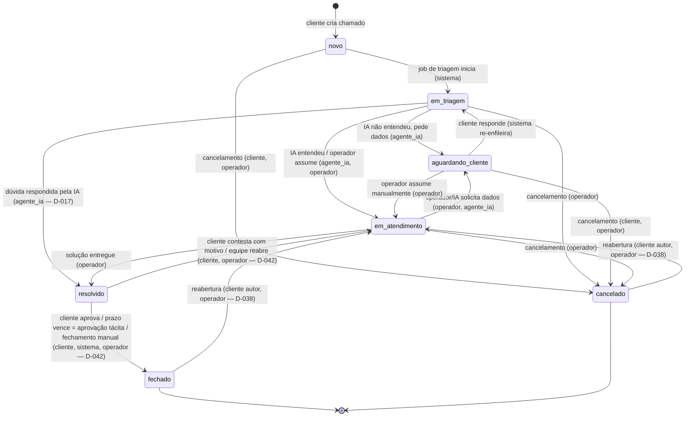

# Chamados: Ciclo de Vida e Regras de Negócio

Este documento define o comportamento funcional da entidade central da plataforma: o **Chamado**. Cobre a máquina de estados, a criação com formulário mínimo, os atributos de classificação (natureza, prioridade, complexidade), a timeline de mensagens e notas internas, rich text e anexos, atribuição de operador, reabertura e fechamento automático, os eventos auditados (`EventoChamado`) e as regras de listagem, filtro e busca.

Escopo relacionado (não duplicado aqui):

- Pipeline de triagem/resolução da IA e geração de SPEC: ver `05-agente-ia.md`.
- Schema de banco, tipos de coluna e estratégia multi-tenant no BD: ver `02-modelo-de-dados.md`.
- Telas, wireframes e fluxos de UI: ver `08-ui-ux.md`.
- Permissões detalhadas por papel e `agente_ia` como service account: ver `03-autenticacao-perfis-permissoes.md`.
- Eventos notificáveis e templates: ver `06-notificacoes.md`.

Papéis referenciados: **admin**, **operador**, **cliente**, **agente_ia** (usuário de serviço). Salvo indicação em contrário, admin possui todas as capacidades de operador.

---

## 1. Máquina de estados

O status de um chamado assume EXATAMENTE um dos valores do enum canônico:

`novo`, `em_triagem`, `aguardando_cliente`, `em_atendimento`, `resolvido`, `fechado`, `cancelado`.

### 1.1 Semântica de cada status

| Status               | Significado                                                                                                                                                                       | Quem geralmente atua                                   |
| -------------------- | --------------------------------------------------------------------------------------------------------------------------------------------------------------------------------- | ------------------------------------------------------ |
| `novo`               | Chamado recém-criado, ainda não enfileirado para triagem ou entre a criação e o início do job.                                                                                    | sistema                                                |
| `em_triagem`         | O `agente_ia` está analisando (job na fila ou em execução).                                                                                                                       | agente_ia                                              |
| `aguardando_cliente` | Falta informação do cliente; a IA ou o operador pediu dados objetivos.                                                                                                            | cliente                                                |
| `em_atendimento`     | Compreendido e em tratamento por operador e/ou IA (diagnóstico, PR, correção).                                                                                                    | operador / agente_ia                                   |
| `resolvido`          | Solução entregue; **janela de aprovação** do cliente solicitante (D-042, §8.1): aprova, contesta com motivo, ou o prazo vence (aprovação tácita).                                 | cliente (aprova/contesta) / sistema (aprovação tácita) |
| `fechado`            | Terminal (encerrado). Encerrado por aprovação do cliente (explícita ou tácita — D-042) ou fechamento manual da equipe. Não recebe novas mensagens. Só sai por reabertura (D-038). | cliente autor / operador (reabrem)                     |
| `cancelado`          | Terminal (encerrado). Encerrado sem solução (duplicado, engano, desistência). Só sai por reabertura (D-038).                                                                      | cliente autor / operador (reabrem)                     |

Estados terminais (encerrados): `fechado` e `cancelado`. Não aceitam mensagens, atribuições, silêncio da IA nem transições — com **uma única exceção (D-038)**: a **reabertura** humana para `em_atendimento` (cliente autor ou operador/admin; nunca `agente_ia` nem `sistema`). No código, `ehTerminal()` continua significando "encerrado salvo reabertura" e `podeReabrir()`/`ehReabertura()` explicitam a exceção (`packages/shared/src/maquina-estados.ts`).

### 1.2 Diagrama

### 1.3 Tabela de transições e autorização

| De                   | Para                 | Gatilho                                                                                                                                                     | Quem pode                                   |
| -------------------- | -------------------- | ----------------------------------------------------------------------------------------------------------------------------------------------------------- | ------------------------------------------- |
| `novo`               | `em_triagem`         | Job de triagem inicia                                                                                                                                       | sistema                                     |
| `novo`               | `cancelado`          | Cancelamento imediato                                                                                                                                       | cliente (autor), operador                   |
| `em_triagem`         | `aguardando_cliente` | IA pede informações objetivas                                                                                                                               | agente_ia, operador                         |
| `em_triagem`         | `em_atendimento`     | IA compreendeu; ou operador assume                                                                                                                          | agente_ia, operador                         |
| `em_triagem`         | `resolvido`          | Dúvida respondida pela IA (D-017)                                                                                                                           | agente_ia, operador                         |
| `em_triagem`         | `cancelado`          | Cancelamento                                                                                                                                                | operador                                    |
| `aguardando_cliente` | `em_triagem`         | Cliente responde (re-enfileira triagem)                                                                                                                     | sistema (disparado por mensagem do cliente) |
| `aguardando_cliente` | `em_atendimento`     | Operador decide assumir sem nova rodada de IA                                                                                                               | operador                                    |
| `aguardando_cliente` | `cancelado`          | Cliente desiste / operador cancela                                                                                                                          | cliente (autor), operador                   |
| `em_atendimento`     | `aguardando_cliente` | Operador ou IA solicita mais dados                                                                                                                          | operador, agente_ia                         |
| `em_atendimento`     | `resolvido`          | Solução entregue                                                                                                                                            | operador                                    |
| `em_atendimento`     | `cancelado`          | Cancelamento                                                                                                                                                | operador                                    |
| `resolvido`          | `em_atendimento`     | **Contestação** pelo cliente (exige mensagem pública na mesma operação — D-042) ou reabertura manual                                                        | cliente (autor), operador                   |
| `resolvido`          | `fechado`            | **Aprovação** pelo cliente (`chamado_aprovado`), prazo vencido = aprovação tácita (`chamado_fechado_auto`) ou fechamento manual (`chamado_fechado`) — D-042 | cliente (autor), sistema, operador          |
| `fechado`            | `em_atendimento`     | Reabertura de chamado encerrado (D-038)                                                                                                                     | cliente (autor), operador                   |
| `cancelado`          | `em_atendimento`     | Reabertura de chamado encerrado (D-038)                                                                                                                     | cliente (autor), operador                   |

Regras invariantes:

- O `cliente` só pode cancelar/reabrir/responder/**aprovar/contestar** **seus próprios** chamados (do seu tenant). Ele **lê** os chamados dos colegas do tenant (D-037), mas não age neles. `agente_ia` nunca aprova nem contesta (D-042).
- Toda transição gera um `EventoChamado` (ver seção 8). Transições inválidas (fora desta tabela) são rejeitadas pela camada de serviço com erro de domínio, sem tocar no banco.
- `fechado` e `cancelado` não aceitam novas mensagens, transições ou atribuições — exceto a reabertura (`→ em_atendimento`, D-038). Qualquer outra transição a partir deles é recusada com `estado_terminal`, inclusive a tentativa de reabertura por `agente_ia`/`sistema`.
- Reenfileiramento da triagem (`aguardando_cliente` → `em_triagem`) só ocorre para chamados ainda não resolvidos; ver `05-agente-ia.md` para as condições exatas do pipeline.
- **Guardrail humano-no-circuito**: para `problema`/`alteracao`, apenas `operador`/`admin` transicionam para `resolvido` — mesmo quando a IA abre um PR de correção, o chamado permanece em `em_atendimento` e aguarda merge/deploy aprovado por humano. **Exceção única (D-017)**: natureza `duvida` respondida pela IA na triagem — a resposta pública é publicada e o chamado vai direto a `resolvido` (`em_triagem` → `resolvido`; o aplicador só usa essa aresta com resposta real, não rebaixada pelo validador). Nada muda no sistema numa dúvida — o guardrail de produção continua intacto. Ver `05-agente-ia.md` (pipeline) e `09-seguranca-lgpd.md` §5 (guardrails de IA).

> DECIDIDO (2026-07-15): valor padrão de N = 3 dias para auto-fechamento de `resolvido`, configurável por tenant — ver §8.1 (implementado no M10). **Substituído pela D-042 (2026-11-17):** N passa a ser o prazo para o cliente aprovar ou contestar, padrão **7 dias** (1–365).

> DECIDIDO (2026-11-17, D-038): **qualquer chamado pode ser reaberto**. Reabertura livre enquanto `resolvido` e também depois de `fechado` ou `cancelado` (`→ em_atendimento`), sem janela de prazo. Operador/admin reabrem qualquer chamado do tenant; o cliente, só os que solicitou. "Abrir novo chamado" com referência ao anterior continua disponível no portal como alternativa.

---

## 2. Criação de chamado (formulário mínimo)

Princípio de produto (RNF-01/RNF-02): o oposto do osTicket. O formulário de abertura pede o mínimo.

Campos do formulário do cliente:

| Campo                        | Obrigatório | Regra                                                                                                                                                                                                                                                                                       |
| ---------------------------- | ----------- | ------------------------------------------------------------------------------------------------------------------------------------------------------------------------------------------------------------------------------------------------------------------------------------------- |
| Sistema-alvo (`SistemaAlvo`) | Condicional | Exibido e obrigatório **apenas** se o tenant tiver mais de um sistema-alvo. Com um único, é preenchido automaticamente. Alternativamente, a categoria geral do tenant.                                                                                                                      |
| Natureza                     | Não (D-017) | `problema`, `alteracao` ou `duvida`. No portal do cliente fica em "Opções avançadas" com default "Automático": sem escolha, abre como `problema` e a IA classifica na triagem (`naturezaAjustada`). No painel (`/app/chamados/novo`, D-040) fica à vista, com o mesmo default "Automático". |
| Título                       | Sim         | Texto curto (ver limites na seção 4).                                                                                                                                                                                                                                                       |
| Descrição                    | Sim         | Rich text com imagens/anexos inline (seção 4).                                                                                                                                                                                                                                              |
| Prioridade                   | Não         | Se omitida, entra como `media` (default) e pode ser ajustada pela IA/operador.                                                                                                                                                                                                              |

Ao criar:

1. Status inicial = `novo`; `tenant_id` derivado do contexto autenticado; autor = usuário logado.
2. Um `EventoChamado` de criação é registrado.
3. Um job de triagem é enfileirado (BullMQ) — ver `05-agente-ia.md`. A transição `novo` → `em_triagem` ocorre quando o worker inicia.
4. Notificação de "chamado criado" é disparada conforme `06-notificacoes.md`.

Quem pode criar: `cliente` (para si), `operador`/`admin` (em nome de um cliente, informando o solicitante). O `agente_ia` não cria chamados.

**Abertura pela equipe — "em nome de" (D-040, resolve a antiga pendência: entra no MVP).** Operador/admin abrem pelo painel em `/app/chamados/novo` (ou pela API/MCP — D-032) com os mesmos campos acima e mais o **solicitante, obrigatório**:

- O solicitante é **sempre** uma conta `cliente` com `status = ativo` do **mesmo tenant** (não existe chamado sem cliente nem com a própria equipe como solicitante). `criarChamado` valida: ausente → `solicitante_obrigatorio`; outro papel, suspenso/pendente/removido ou de outro tenant (RLS: não encontrado) → `solicitante_invalido`.
- O seletor do painel lista os clientes ativos do tenant (nome + e-mail, busca por qualquer um dos dois) via `listarClientesAtivosDoTenant`; só operador/admin recebem a lista. Sem nenhum cliente ativo, a tela orienta a convidar um (`/app/usuarios`, admin).
- No painel, natureza e prioridade ficam à vista (a equipe pode escolher); "Automático" continua default. A equipe também pode informar a **estimativa de custo** já na abertura (opcional, §3.4 — D-043); vai no evento `chamado_criado` e o webhook `criado` já a carrega.
- O efeito é o de qualquer abertura (itens 1–4 acima): autor do chamado = o **cliente** (`cliente_id`), o evento `chamado_criado` registra o operador como ator, o solicitante recebe a confirmação de abertura e a triagem automática é enfileirada. Em seguida a equipe é levada ao detalhe do chamado criado.

---

## 3. Natureza, prioridade e complexidade

### 3.1 Natureza — enum `problema` | `alteracao` | `duvida`

- Opcional na criação pelo portal (D-017): o cliente PODE escolher em "Opções avançadas", mas o caminho normal é deixar "Automático" — a IA identifica a natureza na triagem. Após criado, o cliente não pode mais alterá-la (ver matriz de permissões em `03-autenticacao-perfis-permissoes.md` §8.1).
- A IA **valida/ajusta** a natureza durante a triagem (ex.: cliente marcou `problema`, mas o pedido é uma mudança de comportamento → `alteracao`; ou é só uma pergunta → `duvida`). O ajuste gera `EventoChamado` e nota interna.
- Operador pode alterar manualmente.
- Efeito no pipeline: `alteracao` nunca dispara resolução automática de código; a IA produz uma SPEC (nota interna). `problema` pode disparar tentativa de correção sob os guardrails de `05-agente-ia.md`. `duvida` é respondida pela IA (specs/05 §5.5) — nunca SPEC nem PR.

### 3.2 Prioridade — enum `baixa` | `media` | `alta` | `urgente`

- Opcional na criação (default `media`); é o **único momento** em que o cliente define a prioridade. Após a criação, o cliente não pode mais alterá-la — só operador/admin (decisão) e agente_ia (sugestão) atuam sobre ela (ver matriz de permissões em `03-autenticacao-perfis-permissoes.md` §8.1).
- A IA **sugere** prioridade na triagem; operador **decide**. A sugestão da IA não sobrescreve automaticamente uma prioridade escolhida pelo cliente sem registro.
- Visível para todos os papéis (inclusive cliente).
- Toda alteração de prioridade gera `EventoChamado`.

> DECISÃO PENDENTE: a sugestão da IA aplica automaticamente a prioridade (com evento) ou apenas propõe para o operador confirmar? Sugestão: aplicar automaticamente quando o chamado ainda não foi tocado por operador; a partir daí, apenas sugerir.

### 3.3 Complexidade — enum `facil` | `medio` | `dificil`

- Atributo **interno**. Visível somente para `operador`, `admin` e `agente_ia`. **Nunca** exposto ao `cliente` (nem em API, nem em UI, nem em notificações).
- Definida pela IA na triagem; ajustável por operador.
- Governa a elegibilidade para resolução automática: `natureza=problema` + `complexidade=facil` + bem compreendido → IA pode tentar resolver (ver `05-agente-ia.md`).
- Alterações geram `EventoChamado` de visibilidade interna.

### 3.4 Estimativa de custo e custo final (D-043)

- **Estimativa de custo** — enum `A` (R$ 50–100) · `B` (R$ 100–200) · `C` (R$ 200–400) · `D` (R$ 400–600) · `E` (acima de R$ 600) · `I` (Isento, R$ 0); `NULL` = sem estimativa. Faixas **fixas da plataforma** (não configuráveis por tenant nesta versão); rótulo canônico "B · R$ 100 a R$ 200" (`rotuloEstimativaCusto`, `packages/shared/src/custo.ts`).
  - Quem define: **só operador/admin** (ação `chamado · definir_custo`). Cliente ❌, `agente_ia` ❌ (a triagem não estima custo e o campo não entra no contexto da IA).
  - Quando: em qualquer status **não encerrado** (inclui `resolvido`); em `fechado`/`cancelado` → `estado_terminal` (reabra para alterar). Também na abertura pela equipe (§2).
  - Cada mudança (definir, alterar, limpar) grava `estimativa_custo_alterada` `{de, para}`, notifica (opt-in) e dispara o webhook `estimativa_custo_alterada`. Mesmo valor → nada acontece (idempotente).
- **Custo final** — valor livre em **reais** (`numeric(12,2)`, ≥ 0, no máximo 2 casas, teto 9.999.999.999,99); `NULL` = não informado.
  - Quem informa: **só operador/admin**.
  - Quando: **no ato de marcar como resolvido** (opcional — `transicionarStatus(..., { custo_final })`; a UI pergunta num diálogo de confirmação, a API aceita `custo_final` no `POST …/status` com `status = resolvido`) ou **corrigido enquanto o chamado está `resolvido`** (`definirCustoFinal`). Em outros status não encerrados → `custo_fora_da_resolucao`; encerrado → `estado_terminal`. Numa reabertura/contestação o valor é **mantido** (é o da última resolução) e pré-preenche o diálogo da próxima resolução.
  - Auditoria: `custo_final_definido` `{de, para}` (números). No ato de resolver, o evento leva `origem: 'resolucao'` e **não** notifica nem dispara webhook próprio — o `resolvido` já leva o valor (e-mail e `chamado.custo_final` no webhook). Correção depois → e-mail ao cliente (ligado por padrão) e webhook `custo_final_definido`.
  - Cliente/IA que enviem `custo_final` ao resolver recebem `sem_permissao` (nada é gravado); em transições que não vão para `resolvido` o campo é ignorado pelo domínio (a API recusa antes com `400`).
- **Visibilidade:** estimativa e custo final são **públicos** — o cliente (e os colegas do tenant, D-037) os vê no portal, na API, nos e-mails e no webhook; os dois eventos aparecem no histórico do cliente. A **complexidade** continua interna.
- Entrada na UI em pt-BR: vírgula decimal e ponto de milhar ("1.234,56"); `parsearValorBrl` é a regra única (cliente e servidor).

---

## 4. Timeline: mensagens públicas e notas internas

Cada chamado possui uma sequência ordenada de `Mensagem` (timeline). Cada mensagem tem um autor (usuário de qualquer papel, incluindo `agente_ia`), um corpo em rich text e uma **visibilidade**: `publica` ou `interna`.

### 4.1 Regras de visibilidade

| Visibilidade             | Quem vê                             | Quem pode escrever                  |
| ------------------------ | ----------------------------------- | ----------------------------------- |
| `publica`                | cliente, operador, admin, agente_ia | cliente, operador, admin, agente_ia |
| `interna` (nota interna) | operador, admin, agente_ia          | operador, admin, agente_ia          |

- O `cliente` **nunca** vê mensagens `interna`, nem recebe notificação sobre elas. A API filtra por visibilidade no servidor com base no papel; nunca confia no cliente para ocultar.
- Notas internas são o canal da IA para diagnóstico, plano de resolução, link de PR e SPEC de alteração.
- Mensagens públicas do cliente em chamados `aguardando_cliente`/`em_triagem` podem re-disparar a triagem (ver seção 1.3 e `05-agente-ia.md`).

### 4.2 Efeitos de uma nova mensagem

- Nova mensagem `publica` do operador/IA em `aguardando_cliente` mantém o status até o cliente responder (ou operador transiciona manualmente).
- **Quem responde fica responsável (D-039):** nova mensagem `publica` de `operador`/`admin` torna o autor o responsável pelo chamado (`operador_id`), substituindo o anterior — ver §7. Nota `interna`, mensagem do `agente_ia` e do `cliente` não atribuem.
- Nova mensagem `publica` do cliente re-dispara a triagem em QUALQUER estado não terminal (D-017 parte 3): de `aguardando_cliente` → `em_triagem` (sistema); de `resolvido` → é a **contestação** da solução (D-042, §8.1): reabre (§8.2) com evento `chamado_contestado` e a triagem analisa; em `novo`/`em_triagem`/`em_atendimento` apenas re-enfileira (sem mudar status). O operador atribuído segue sendo notificado.
- Toda nova mensagem `publica` gera evento notificável ("nova mensagem publica"); notas `interna` notificam apenas a equipe conforme preferências.
- Mensagens são **imutáveis** após o envio no MVP (sem edição/exclusão), preservando a integridade da timeline.

> DECISÃO PENDENTE: permitir editar/excluir a própria mensagem dentro de uma janela curta (ex.: 5 min) ou manter imutável no MVP. Sugestão: imutável no MVP; adicionar "editar em 5 min" depois, mantendo histórico.

---

## 5. Rich text

Formato e sanitização (detalhes de storage em `02-modelo-de-dados.md`; segurança/XSS em `09-seguranca-lgpd.md`):

- Editor: **TipTap**. Persistência como HTML sanitizado no servidor (allowlist de tags/atributos) — nunca renderizar HTML bruto do cliente.
- Recursos suportados: parágrafos, títulos, negrito/itálico/sublinhado/tachado, listas ordenadas/não ordenadas, citações, blocos de código com destaque, links, tabelas simples e **imagens inline**.
- Imagens inline são anexos: fazem upload para o storage S3-compatível e o corpo referencia a URL/asset resultante (não base64 embutido no HTML).
- **Pré-processamento de imagens coladas (obrigatório, ANTES da sanitização).** Ao colar uma imagem, o TipTap emite `` (base64 embutido). No servidor, antes de aplicar a allowlist: (1) extrair cada imagem `data:` do documento; (2) fazer upload como `Anexo` (`inline=true`, vinculado ao `tenant_id` e ao chamado/mensagem); (3) reescrever o `src` para a referência do `Anexo` (URL assinada); (4) só então aplicar a allowlist de sanitização, que remove `data:`. Sem esse passo, a sanitização descartaria o `data:` e a imagem colada sumiria silenciosamente. Ver `09-seguranca-lgpd.md` §6.
- Sanitização server-side obrigatória na escrita (remoção de scripts, handlers `on*`, `javascript:` URIs, iframes). Ver `09-seguranca-lgpd.md`.

Limites:

| Item                        | Limite (sugerido)                                                               |
| --------------------------- | ------------------------------------------------------------------------------- |
| Título                      | 3–160 caracteres (alinhado ao `CHECK length 3..160` de `02-modelo-de-dados.md`) |
| Corpo (descrição/mensagem)  | até 50.000 caracteres de texto renderizado                                      |
| Imagens inline por mensagem | até 20                                                                          |

> DECISÃO PENDENTE: valores exatos dos limites de título e corpo. Números acima são propostas iniciais.

---

## 6. Anexos

`Anexo` cobre tanto imagens inline quanto arquivos anexados à parte, sempre vinculados a uma `Mensagem` (ou à descrição do chamado) e ao `tenant_id`.

| Regra                          | Valor (sugerido)                                                                                    |
| ------------------------------ | --------------------------------------------------------------------------------------------------- |
| Tipos permitidos               | Imagens (png, jpg, webp, gif), PDF, texto/logs (txt, log, csv), documentos comuns (docx, xlsx), zip |
| Tamanho máximo por arquivo     | 25 MB                                                                                               |
| Quantidade por mensagem        | até 20                                                                                              |
| Quota por chamado / por tenant | Configurável por tenant (ver `07-multitenancy-whitelabel.md`)                                       |

- Validação de tipo por **conteúdo** (magic bytes), não apenas extensão/MIME informado.
- Executáveis e tipos ativos são bloqueados por allowlist. Ver `09-seguranca-lgpd.md`.
- Upload direto para storage S3-compatível (MinIO em dev; S3/R2 em prod) via URL pré-assinada; o banco guarda metadados e chave do objeto.
- Acesso a anexos respeita a visibilidade da mensagem: anexo de nota `interna` nunca é servido ao cliente. Downloads passam por URL pré-assinada de curta duração emitida após checagem de permissão.

> DECISÃO PENDENTE: lista definitiva de tipos permitidos, tamanho máximo por arquivo e política de quota (por chamado, por tenant, por período). Números acima são propostas iniciais.

---

## 7. Atribuição de operador

- Um chamado pode ter **um operador responsável** (assignee) por vez. O `agente_ia` participa como operador automatizado, mas não ocupa o slot de assignee humano — sua atuação é registrada via mensagens e `ExecucaoIA`.
- Atribuir/reatribuir: `operador` (auto-atribuição ou entre pares) e `admin`. O `cliente` nunca atribui. O alvo precisa ser usuário **ativo** com papel `operador` ou `admin` do mesmo tenant (o universo do seletor do painel); fora disso a atribuição é recusada (`operador_invalido`). Também disponível pela API (`POST /api/v1/chamados/{ref}/atribuicao`, specs/11 §4.9 — D-036).
- Desatribuir é permitido; chamado volta a "não atribuído".
- Atribuição não altera o status por si só, mas frequentemente acompanha a transição para `em_atendimento`.
- Toda (re)atribuição gera `EventoChamado` e pode notificar o novo responsável (ver `06-notificacoes.md`).

### 7.1 Quem responde fica responsável (D-039)

- Quando um `operador` ou `admin` publica uma **mensagem `publica`** (resposta ao cliente), ele passa a ser o responsável pelo chamado, **substituindo** quem estava atribuído. Predicado puro `respostaAtribui()` (`packages/shared/src/atribuicao.ts`).
- **Não atribuem:** nota `interna`; mensagem do `agente_ia` (nunca ocupa o slot, ver acima); mensagem do `cliente`. Se o autor **já é** o responsável, nada acontece (sem evento duplicado).
- A regra vive na camada de serviço (`criarMensagem`, `packages/db`), **dentro da mesma transação** da mensagem, reutilizando `atribuirOperador` (alvo ativo, evento, notificação). Vale igual para o painel (`acaoResponder`), para a API (`POST /api/v1/chamados/{ref}/mensagens` — MCP e Forja) e para qualquer outro chamador.
- Efeitos: evento `operador_atribuido` com **ator = o próprio autor** e `dados = {operador_anterior, operador_novo, motivo: "resposta_publica"}`, gravado **depois** do `mensagem_publicada` (a timeline lê "respondeu → assumiu"; o painel mostra "assumiu o chamado ao responder"). Notificação `atribuicao`: o destinatário é o novo responsável, que é o autor — e o autor nunca é notificado da própria ação (specs/06), então não sai e-mail; o **webhook `atribuicao`** sai como em qualquer atribuição. A notificação `mensagem_publica` é resolvida **antes** da troca, então o responsável anterior (se havia) recebe o aviso da resposta de quem assumiu. Não há aviso dedicado de "você deixou de ser o responsável" (o catálogo não tem esse destinatário).
- Best-effort dentro da transação: se o autor não for alvo válido (ex.: suspenso entre o login e o envio), a mensagem é publicada sem a atribuição.
- Atribuição manual (seletor, API L4) continua valendo e é respeitada até a próxima resposta pública de **outro** membro da equipe.
- O status não muda por causa da atribuição; se o mesmo fluxo também transiciona (ex.: responder e mover para `aguardando_cliente`, como a Forja faz), a atribuição acontece igual.

> DECISÃO PENDENTE: haverá atribuição automática (round-robin, por sistema-alvo, por carga) no MVP ou apenas manual? Sugestão: manual no MVP; regras automáticas como item de roadmap (`10-roadmap-mvp.md`). **Atualização (D-039):** a única regra automática do MVP é "quem responde em público fica responsável" (§7.1); round-robin/carga seguem no roadmap.

---

## 8. Janela de aprovação, fechamento automático e reabertura

### 8.1 Janela de aprovação do cliente (`resolvido`) — D-042

- Ao entrar em `resolvido`, registra-se o timestamp da resolução (`resolvido_em`) e calcula-se o **prazo de aprovação** (`fechar_automaticamente_em = resolvido_em + dias_fechamento_automatico`, padrão **7 dias**, 1–365, editável em `/app/config`). O prazo é materializado na resolução: mudar a config vale para as próximas. O prazo é exposto ao cliente (portal, e-mail de resolvido, API).
- Enquanto `resolvido`, o **cliente solicitante** (só ele — colegas do tenant leem, D-037, mas não agem):
  - **Aprova** — `resolvido → fechado`: evento `chamado_aprovado` (`dados.aprovacao = 'explicita'`), `fechado_em` gravado; notificação `aprovado` à equipe e webhook `aprovado` (`forma: 'explicita'`). Portal: botão **Aprovar**; API: `POST /api/v1/chamados/{ref}/status {"status":"fechado"}`.
  - **Contesta** — exige **motivo**: publica uma mensagem pública e o chamado volta a `em_atendimento` (evento `chamado_contestado` com `dados.mensagem_id`, no lugar de `chamado_reaberto`; `reaberto_count` + 1; prazo limpo); a mensagem re-dispara a triagem como qualquer resposta pública do cliente (D-017; IA silenciada descarta o job). Notificação `contestado` (equipe) e webhook `contestado`. Portal: botão **Contestar** (diálogo com motivo obrigatório); API: `POST …/mensagens` — um `POST …/status {"status":"em_atendimento"}` do cliente num `resolvido` responde `409 motivo_obrigatorio` (o domínio exige a mensagem pública na mesma transação).
- **Sem resposta até o prazo = aprovação tácita.** Um job **repetível** de manutenção (BullMQ repeatable, a cada **5 minutos** por padrão, intervalo configurável) enumera os tenants ativos (`chamados_tenants_ativos()`, ver `02-modelo-de-dados.md`) e, para cada um, varre os chamados `resolvido` com `fechar_automaticamente_em` vencido (`FOR UPDATE SKIP LOCKED`), transicionando-os para `fechado` como `sistema` — `EventoChamado` `chamado_fechado_auto` com `dados.aprovacao = 'tacita'`, notificação `aprovado` (cliente e responsável) e **webhook `aprovado` (`forma: 'tacita'`)**. A entrega do webhook é garantida: a chave de idempotência deriva do id do evento, e a varredura reconcilia os webhooks de aprovação tácita das últimas 24 h que não chegaram ao `notificacao_log` (specs/06 §3.2).
- A equipe mantém as ações que já tinha: fechar manualmente (`chamado_fechado` — **não** é aprovação) e reabrir (`chamado_reaberto`). O painel mostra o prazo e, depois, como foi aprovado (cliente em <data> / tacitamente em <data>).

> DECIDIDO (2026-07-15, M10): auto-fechamento com default 3 dias. **Revisto pela D-042 (2026-11-17)**: o mesmo job passa a registrar a aprovação tácita; default 7; migration 0013 levou a 7 os tenants que estavam em 3 (suposição documentada no ADR).

### 8.2 Reabertura

- Enquanto `resolvido`, a reabertura pelo `cliente` (autor) é a **contestação** (§8.1): exige mensagem pública — o botão "Reabrir" de um clique não existe nesse estado. Enviar uma nova mensagem pública em `resolvido` **é** contestar (D-017 parte 3): status volta para `em_atendimento`, evento `chamado_contestado`, notificação à equipe; a mensagem re-dispara a triagem.
- Operador/admin também podem reabrir manualmente.
- **`fechado` e `cancelado` também reabrem (D-038)** — só pela ação explícita "Reabrir" (painel, portal, `POST /api/v1/chamados/{ref}/status {status:"em_atendimento"}`, MCP `chamado_alterar_status`): operador/admin em qualquer chamado do tenant; cliente só nos seus. Mensagem do cliente em chamado encerrado continua recusada (`estado_terminal`) — reabrir é sempre um ato explícito.
- **Efeitos de toda reabertura** (de `resolvido`, `fechado` ou `cancelado`): status `em_atendimento`; `reaberto_count` + 1; `resolvido_em`, `fechar_automaticamente_em` e `fechado_em` limpos; `EventoChamado` `chamado_reaberto` (`dados.de` informa a origem) — ou `chamado_contestado` quando é o cliente contestando um `resolvido` (D-042, notificação `contestado` e webhook `contestado` em vez dos abaixo); notificação `reaberto` (operador obrigatório, confirmação ao autor) e webhook `status_alterado`, como já acontecia. Operador atribuído, natureza, prioridade e complexidade ficam como estavam.
- **Triagem:** a reabertura pela ação explícita **não** dispara triagem (comportamento que já valia para `resolvido`); só a mensagem pública do cliente re-enfileira (§4.2). Um chamado `cancelado` ainda em `novo` (nunca triado) volta direto a `em_atendimento`, sem classificação da IA: fica com a equipe, e a primeira mensagem pública do cliente depois disso dispara a triagem normalmente (gatilho `resposta_cliente`).

---

## 9. EventoChamado (auditoria/histórico)

Todo fato relevante gera um registro `EventoChamado` imutável (append-only), com: tenant, chamado, ator (usuário/papel, incluindo `sistema` e `agente_ia`), tipo do evento, timestamp, e payload com o antes/depois quando aplicável. Detalhes de schema em `02-modelo-de-dados.md`.

Eventos auditados (lista mínima):

Os nomes de tipo abaixo correspondem EXATAMENTE ao enum `tipo_evento` de `02-modelo-de-dados.md`. Resolução (`→ resolvido`) e cancelamento (`→ cancelado`) têm tipo dedicado (`chamado_resolvido`, `chamado_cancelado`), assim como fechamento manual (`chamado_fechado`), reabertura, aprovação e contestação; as demais transições são registradas como `status_alterado` com `{de, para}`. As ações da IA usam os tipos `ia_*` específicos, cada um referenciando a `ExecucaoIA` correspondente.

| Tipo de evento              | Origem típica                                  | Payload                                                                                                                                                                                 |
| --------------------------- | ---------------------------------------------- | --------------------------------------------------------------------------------------------------------------------------------------------------------------------------------------- |
| `chamado_criado`            | cliente/operador                               | dados iniciais                                                                                                                                                                          |
| `status_alterado`           | transições sem tipo dedicado                   | de → para (+ motivo quando cancelamento/fechamento manual)                                                                                                                              |
| `prioridade_alterada`       | IA/operador                                    | de → para                                                                                                                                                                               |
| `natureza_alterada`         | IA/operador                                    | de → para                                                                                                                                                                               |
| `complexidade_alterada`     | IA/operador                                    | de → para (interno)                                                                                                                                                                     |
| `atribuicao_alterada`       | operador/admin                                 | assignee anterior → novo (`novo = NULL` na desatribuição); `motivo = resposta_publica` na auto-atribuição por resposta (D-039). No código: `operador_atribuido`/`operador_desatribuido` |
| `mensagem_publicada`        | qualquer papel                                 | id da mensagem (visibilidade `publica`)                                                                                                                                                 |
| `nota_interna_publicada`    | operador/admin/agente_ia                       | id da mensagem (visibilidade `interna`)                                                                                                                                                 |
| `anexo_adicionado`          | qualquer papel                                 | id do anexo, `mensagem_id`/`chamado_id`                                                                                                                                                 |
| `chamado_resolvido`         | operador/admin; agente_ia (só `duvida`, D-017) | `{de, para}`                                                                                                                                                                            |
| `chamado_cancelado`         | cliente/operador                               | `{de, para}` (+ motivo)                                                                                                                                                                 |
| `chamado_fechado`           | operador/admin                                 | `{de, para}` — fechamento manual (não é aprovação)                                                                                                                                      |
| `chamado_reaberto`          | cliente/operador                               | `{de, para}` — reabertura de `fechado`/`cancelado` (D-038) ou de `resolvido` pela equipe                                                                                                |
| `chamado_aprovado`          | cliente (solicitante)                          | `{de: resolvido, para: fechado, aprovacao: 'explicita'}` — aprovação explícita (D-042)                                                                                                  |
| `chamado_contestado`        | cliente (solicitante)                          | `{de: resolvido, para: em_atendimento, mensagem_id}` — contestação com motivo (D-042)                                                                                                   |
| `estimativa_custo_alterada` | operador/admin                                 | `{de, para}` — códigos da faixa ou `null` (D-043); público                                                                                                                              |
| `custo_final_definido`      | operador/admin                                 | `{de, para}` em BRL (números ou `null`); `origem: 'resolucao'` quando veio no ato de resolver (D-043); público                                                                          |
| `chamado_fechado_auto`      | sistema                                        | `{motivo: 'auto_fechamento_prazo', aprovacao: 'tacita'}` — **aprovação tácita** (prazo vencido — D-042). Fechamento manual da equipe é `chamado_fechado`                                |
| `ia_iniciou`                | agente_ia                                      | referência a `ExecucaoIA` (início da triagem)                                                                                                                                           |
| `ia_pediu_info`             | agente_ia                                      | referência a `ExecucaoIA` (pedido de dados; acompanha `status_alterado` → `aguardando_cliente`)                                                                                         |
| `ia_diagnosticou`           | agente_ia                                      | referência a `ExecucaoIA` (nota interna de diagnóstico)                                                                                                                                 |
| `ia_abriu_pr`               | agente_ia                                      | referência a `ExecucaoIA` (branch/PR de correção)                                                                                                                                       |
| `ia_gerou_spec`             | agente_ia                                      | referência a `ExecucaoIA` (SPEC de alteração)                                                                                                                                           |
| `ia_falhou`                 | agente_ia                                      | referência a `ExecucaoIA` (erro/timeout)                                                                                                                                                |
| `ia_silenciada`             | operador/admin                                 | D-024: IA silenciada no chamado (`{de, para}`); interno                                                                                                                                 |
| `ia_reativada`              | operador/admin                                 | D-024: IA reativada no chamado; interno                                                                                                                                                 |

- Eventos de atributos internos (ex.: `complexidade_alterada`) e notas internas (`nota_interna_publicada`) herdam a visibilidade interna: não aparecem no histórico do cliente.
- Detalhamento das ações da IA e da entidade `ExecucaoIA`: ver `05-agente-ia.md`.

---

## 10. Listagens, filtros e busca

### 10.1 Visões por papel

- **Cliente**: vê todos os chamados do seu tenant, sempre na visão pública (D-037, decisão do usuário) — a tela abre no recorte **"Meus chamados"** (os que ele solicitou) e oferece **"Todos os chamados"**, onde cada item mostra o nome do solicitante. Nos chamados alheios ele só lê: responder, anexar, reabrir e cancelar seguem exclusivos do solicitante (§1.3). Colunas: título, status, prioridade, natureza, última atualização (+ solicitante no recorte "todos"). Histórico inclui chamados `fechado`/`cancelado` (RF-04). Nunca vê complexidade nem itens internos.
- **Operador/Admin**: veem todos os chamados do tenant (admin pode ter visão administrativa ampla). Colunas adicionais: complexidade, operador atribuído, indicador de atividade da IA. A projeção da fila (`listarFilaChamados`) também traz `estimativa_custo` e `custo_final` (D-043). No portal, os cards mostram a estimativa e, quando houver, o custo final.

Todo acesso é filtrado por `tenant_id` no servidor (Row-Level Security no PostgreSQL — ver `02-modelo-de-dados.md` e `07-multitenancy-whitelabel.md`).

### 10.2 Filtros

Filtros combináveis: status, natureza, prioridade, complexidade (só operador/admin), estimativa de custo (D-043: uma ou mais faixas e/ou `sem_estimativa` — `FiltrosFila.estimativa_custo`), sistema-alvo, operador atribuído, autor/cliente, intervalo de datas (criação/última atualização), com/sem atividade da IA.

**Fila do painel (D-045)** — `FiltrosFila` em `@chamados/db`, parâmetros de URL em `apps/web/src/lib/fila-params.ts` (fonte única de parse/validação; valor inválido = filtro ausente, nunca erro):

| Pergunta do operador | Parâmetro de URL                                | `FiltrosFila`                                                   |
| -------------------- | ----------------------------------------------- | --------------------------------------------------------------- |
| Qual recorte?        | `situacao` (D-030)                              | `situacao`                                                      |
| O quê?               | `q`                                             | `busca` (§10.4)                                                 |
| De quem?             | `responsavel` = `meus` \| `nenhum` \| UUID      | `atribuicao` / `operador_id` (o UUID tem precedência)           |
| Em que estado?       | `status`                                        | `status`                                                        |
| Quão urgente?        | `prioridade`                                    | `prioridade`                                                    |
| Que tipo?            | `natureza`, `complexidade`                      | idem                                                            |
| Onde?                | `sistema` **ou** `categoria` (UUID; o "alvo")   | `sistema_alvo_id` / `categoria_id`                              |
| Pedido por quem?     | `solicitante` (UUID)                            | `cliente_id`                                                    |
| Quanto custa?        | `estimativa` (A–E, I, `sem_estimativa`)         | `estimativa_custo`                                              |
| Quando?              | `periodo` (`criado`\|`atualizado`) + `de`/`ate` | `periodo` (AAAA-MM-DD, inclusivas, no fuso `America/Sao_Paulo`) |

O legado `atribuicao=meus|nao_atribuidos` (links do dashboard) continua aceito. Na consulta, UUID ou data malformados que cheguem ao serviço viram **nenhum resultado** (fail-closed — nunca ampliam o recorte nem chegam ao SQL sem bind). Contadores (`contarFila`): `porStatus` e `porSituacao` (D-030), `porOperador` + `meus`/`naoAtribuidos`/`total` (ignorando o próprio filtro de responsável) e `filtrados` (o recorte completo — o "N chamados" da tela).

**Situação (D-030).** Acima de tudo isso, a fila do painel tem um recorte de primeira ordem em três valores:

| Situação     | Status incluídos                                             |
| ------------ | ------------------------------------------------------------ |
| `abertos`    | `novo`, `em_triagem`, `aguardando_cliente`, `em_atendimento` |
| `encerrados` | `resolvido`, `fechado`, `cancelado`                          |
| `todos`      | os sete                                                      |

Os dois grupos **particionam** os sete status canônicos (fonte única: `STATUS_ABERTOS`/`STATUS_ENCERRADOS` em `@chamados/shared`). `resolvido` conta como encerrado embora **não** seja terminal (§1.1): ainda é reabrível pelo cliente, mas já saiu do trabalho do dia. O padrão da tela é `abertos`; um `status` explícito na URL define a situação correspondente e uma busca textual varre `todos` (para não esconder um chamado fechado de quem procurou por ele). Situação e `status` combinam por **interseção**.

### 10.3 Ordenação

Por última atualização (default, desc), data de criação, prioridade, status.

**Implementado na fila do painel (D-045):** `FiltrosFila.ordenacao = { campo, direcao }` com `campo` ∈ `atualizado` (padrão, desc) · `criado` · `prioridade` (ordem do enum: `baixa` < `media` < `alta` < `urgente`; empate pela atualização mais recente) · `numero`. Toda ordenação termina em `id` (ordem total, determinística). Com busca full-text e **sem** ordenação escolhida, vale a relevância (§10.4); escolher uma coluna sobrepõe a relevância. Ordenar por status fica de fora (a situação/status já recortam). URL: `ordem` + `dir` (`asc`|`desc`).

### 10.3.1 Exportação para planilha (D-045)

O recorte atual pode ser baixado como `.xlsx` — **todos** os chamados do recorte, não só a página, até 10.000 linhas (`TETO_EXPORTACAO`; acima disso o arquivo sai `-parcial` e a aba avisa "primeiros 10000"), na mesma ordem da tela:

- **Painel** (`GET /app/chamados/exportar?<mesmos parâmetros da fila>`, operador/admin): Nº, Título, Status, Natureza, Prioridade, Complexidade, Solicitante, E-mail do solicitante, Sistema / categoria, Responsável, Estimativa de custo (rótulo da faixa), Custo final (R$, numérico com formato moeda), Criado em, Atualizado em, Resolvido em, Fechado em (datas nativas do Excel, `dd/mm/aaaa hh:mm`, fuso `America/Sao_Paulo`), Reaberturas. `exportarFilaChamados` reaproveita os mesmos `aplicarFiltros`/`aplicarOrdenacao` da tela.
- **Portal** (`GET /portal/exportar?ver=&aba=&status=&q=`, cliente): o recorte Meus/Todos + aba/status/busca do portal, só com colunas da visão pública (`03` §7) — Nº, Título, Status, Natureza, Prioridade, Solicitante ("Você" nos próprios), Sistema / categoria, Estimativa, Custo final, datas e Reaberturas; nada de complexidade, responsável, e-mails ou IA (`exportarChamadosVisaoPublica`, allowlist própria).
- Arquivo `chamados-<slug-do-tenant>-<AAAA-MM-DD>.xlsx` (data de São Paulo), `Content-Disposition: attachment`, `Cache-Control: private, no-store`. Segurança (injeção de fórmula): `09` §6.1.

### 10.4 Busca

> DECIDIDO (2026-07-15): busca full-text com `websearch_to_tsquery('portuguese')` sobre a coluna gerada `busca_tsv` (título peso A + descrição peso B — ver `02-modelo-de-dados.md`), com **ranking** por relevância (`ts_rank`/`ts_rank_cd`, título pesando mais que o corpo da descrição) e **fallback** para `ILIKE` quando o termo é curto demais para `websearch_to_tsquery` produzir um `tsquery` útil (ex.: 1-2 caracteres, siglas). No modo busca (termo preenchido), a ordenação é por relevância, substituindo a ordenação padrão de §10.3. MVP indexa **título + descrição** do chamado; mensagens (públicas e notas internas) ficam fora do índice de busca (implementado no M10).

- A busca respeita RLS e o isolamento por tenant no nível da query; o resultado só retorna chamados visíveis ao papel de quem busca (o cliente alcança o tenant na visão pública — D-037; no portal, a busca respeita o recorte "Meus"/"Todos" e varre abertos + histórico — ver §10.1). Como `busca_tsv` cobre só título e descrição (campos públicos), o resultado nunca é influenciado por nota interna.

> DECIDIDO (D-045): **fila do painel = offset limitado**; **API `/api/v1` e portal = keyset** por `(updated_at, id)`. A fila tem ordenação escolhida pelo operador, "N chamados", tamanho de página (25/50/100) e anterior/próxima — keyset não suporta ordenação arbitrária com segurança (o cursor teria de codificar cada chave e a direção, e "anterior" exigiria inverter a consulta). Offset com ordem total (`… , id`) não repete nem pula linhas paradas; o custo é limitado por `OFFSET_MAX_FILA` = 10.000 (além disso a tela pede para refinar os filtros ou exportar). Trade-off aceito: um chamado atualizado entre duas páginas pode "mudar de página" — o mesmo já acontecia com o keyset por `updated_at`. A API e o portal ("Carregar mais") seguem no keyset, sem mudança de contrato.

---

## 11. Resumo das regras invariantes

1. Status sempre um dos sete valores do enum canônico; transições restritas à tabela da seção 1.3.
2. `fechado` e `cancelado` são terminais (encerrados): sem mensagens, transições ou atribuições — a única saída é a reabertura humana para `em_atendimento` (D-038).
   2a. `resolvido` é a janela de aprovação (D-042): só o cliente solicitante aprova (→ `fechado`) ou contesta com motivo (→ `em_atendimento`); o silêncio até o prazo é aprovação tácita, sempre com webhook `aprovado`.
3. `complexidade` é interna: invisível ao cliente em toda superfície (UI, API, notificações, histórico). Já `estimativa_custo` e `custo_final` são públicos, mas só operador/admin os definem (D-043, §3.4).
4. Visibilidade de mensagem filtrada no servidor por papel; cliente jamais acessa conteúdo `interna`.
5. Todo fato relevante gera `EventoChamado` append-only. Resposta `publica` de `operador`/`admin` torna o autor o responsável (D-039, §7.1); nota interna, IA e cliente nunca atribuem.
6. Todo acesso é isolado por `tenant_id` (RLS).
7. Rich text e anexos são sanitizados/validados server-side antes de persistir e servidos por URL pré-assinada conforme permissão.
