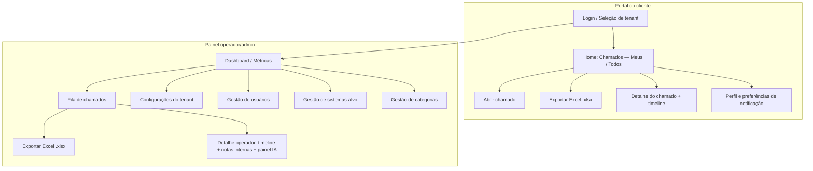

# UI/UX: Telas e Fluxos

Este documento define o mapa de telas, os wireframes das telas principais, os fluxos de interação e os princípios de UX da plataforma **Chamados**. O foco é o _como_ a interface se organiza e responde; regras de negócio (ciclo de vida, máquina de estados) vivem em `04-chamados.md`, a matriz de permissões em `03-autenticacao-perfis-permissoes.md`, o pipeline de IA em `05-agente-ia.md`, e o branding whitelabel é detalhado em `07-multitenancy-whitelabel.md` (aqui tratamos só de sua aplicação visual).

Princípio-guia (RNF-01, RNF-02): **formulários mínimos, UX moderna e rápida, IA-first**. Cada tela deve poder ser justificada contra esses três valores.

---

## 1. Áreas da aplicação

A aplicação se divide em duas áreas de UI com layouts distintos, servidas sob o domínio/subdomínio do tenant (ver `07-multitenancy-whitelabel.md`):

| Área                      | Papéis (ver `03-`)  | Objetivo                                           | Densidade visual                             |
| ------------------------- | ------------------- | -------------------------------------------------- | -------------------------------------------- |
| **Portal do cliente**     | `cliente`           | Abrir e acompanhar chamados com o mínimo de atrito | Baixa — espaçoso, poucos controles           |
| **Painel operador/admin** | `operador`, `admin` | Triagem, atendimento, configuração e produtividade | Alta — tabelas densas, atalhos, multi-painel |

O `agente_ia` não tem UI própria: ele atua como autor de mensagens e eventos, aparecendo na timeline e no painel de ações da IA (ver §4.3). Um mesmo usuário humano pode ter acesso às duas áreas se acumular papéis; a navegação entre elas é feita por um seletor de contexto no topo.

> DECISÃO PENDENTE: portal do cliente e painel operador podem ser dois apps Next.js separados (rotas `/portal` e `/app`) ou um único app com layouts condicionais por papel. Recomendação: rotas segregadas no mesmo app, compartilhando design system.

---

## 2. Mapa de telas



### 2.1 Telas do portal do cliente

| Tela                      | Rota sugerida          | Conteúdo essencial                                                                                                              |
| ------------------------- | ---------------------- | ------------------------------------------------------------------------------------------------------------------------------- |
| Login / seleção de tenant | `/login`               | Resolução de tenant por subdomínio; e-mail/senha (ver `03-`)                                                                    |
| Chamados                  | `/portal`              | Recorte "Meus" (padrão) / "Todos" do tenant (D-037); abas e status; busca; "Abrir chamado"; "Exportar Excel" do recorte (D-045) |
| Exportar lista (.xlsx)    | `/portal/exportar`     | Download do recorte atual do portal, só colunas da visão pública (D-045)                                                        |
| Abrir chamado             | `/portal/novo`         | Formulário mínimo (§4.1)                                                                                                        |
| Detalhe do chamado        | `/portal/chamados/:id` | Cabeçalho, timeline `publica`, caixa de resposta (só nos próprios — alheio é somente leitura)                                   |
| Perfil e notificações     | `/portal/perfil`       | Dados, canais e `PreferenciaNotificacao` (ver `06-notificacoes.md`)                                                             |

### 2.2 Telas do painel operador/admin

| Tela                    | Rota sugerida            | Conteúdo essencial                                                                                                            | Papel mínimo |
| ----------------------- | ------------------------ | ----------------------------------------------------------------------------------------------------------------------------- | ------------ |
| Dashboard               | `/app`                   | KPIs, gráficos, filas por status, atalhos                                                                                     | operador     |
| Fila de chamados        | `/app/chamados`          | Fila filtrável/ordenável com paginação, chips de filtros ativos, "Exportar Excel" e "Novo chamado" (§4.4, D-045)              | operador     |
| Exportar fila (.xlsx)   | `/app/chamados/exportar` | Download (route handler, cookie de sessão) do recorte atual da fila — mesmos parâmetros de URL (D-045)                        | operador     |
| Novo chamado            | `/app/chamados/novo`     | Abrir chamado em nome de um cliente ativo (§4.6, D-040)                                                                       | operador     |
| Detalhe operador        | `/app/chamados/:id`      | Timeline (públicas + internas), painel de ações da IA, controles de status/prioridade/atribuição/complexidade                 | operador     |
| Configurações do tenant | `/app/config`            | Branding, prazo de aprovação do cliente (D-042), guardrails, Assistente IA (instruções, modelo/esforço/timeout), notificações | admin        |
| Gestão de usuários      | `/app/usuarios`          | Lista, convites, papéis                                                                                                       | admin        |
| Gestão de sistemas-alvo | `/app/sistemas`          | CRUD de `SistemaAlvo` (repo git, logs, conexão BD somente leitura)                                                            | admin        |
| Gestão de categorias    | `/app/categorias`        | CRUD de `Categoria` do tenant                                                                                                 | admin        |

---

## 2.3 Linguagem visual v2 (D-018 — "levemente 3D", inspiração Cloudflare)

A estética do design system (refina D-009, sem substituí-lo): controles **levemente 3D** — botões e inputs com gradiente vertical sutil, borda 1px um tom mais escura que o preenchimento, realce interno no topo e estado _pressed_ afundando; cards com borda nítida + sombra sutil (hover eleva); superfícies flutuantes (dialog/menu/select) com sombra própria; cabeçalhos de tabela discretos (caps/muted); sidebar com indicador de item ativo em barra de acento. Regras estruturais:

- **Campo é campo**: todo controle de formulário (input, textarea, select, editor) tem superfície **`bg-card`** no claro e `bg-input/30` no escuro — nunca `bg-transparent`, que sobre o `--background` da página apaga a leitura de "aqui se digita" (corrigido em D-030, na tela e nos primitivos ao mesmo tempo).
- **Tudo vive nos tokens** (`globals.css`): sombras (`--shadow-ctrl*`, `--shadow-campo`, `--shadow-cartao*`, `--shadow-flutuante`), gradientes (`--grad-*`) e realces (`--realce-*`); componentes `ui/*` apenas referenciam os tokens — um único lugar controla a linguagem.
- **Whitelabel intocado**: todo efeito que envolve a cor primária DERIVA de `var(--primary)` via `color-mix()` — o branding por tenant recolore a UI inteira; sombras/realces são neutros (profundidade, não marca). Claro/escuro têm overrides próprios dos realces.
- **Fonte**: Geist (via `next/font`) — a v1 tinha um bug de auto-referência (`--font-sans: var(--font-sans)`) que fazia o app inteiro renderizar na serifada do navegador.

### 2.3.1 Paleta padrão do produto (D-019)

Identidade visual default, aplicada quando o tenant não tem branding (ou quando a cor cadastrada reprova no contraste AA):

- **Primário azul-petróleo** — claro: `oklch(0.46 0.09 215)`; escuro: `oklch(0.76 0.09 210)` com foreground escuro. Matiz calmo/confiável que não colide com as cores de status do domínio (sky/violet/amber/indigo/emerald).
- **Neutros frios** (chroma ≤ 0.02, matiz ~230–250): fundo, muted e bordas levemente tingidos de azul — nunca cinza puro. Discretos o bastante para conviver com qualquer cor de marca de tenant.
- **Sidebar escura nos dois temas** (âncora de identidade do painel; o sheet mobile usa a mesma superfície): tinta azul-petróleo profunda. Item ativo e chip da marca derivam de `var(--primary)` **clareado** via `color-mix(..., white 45%)` — contraste garantido sobre o fundo escuro mesmo com marca de tenant escura. A sidebar prefere a variante **dark** do logo (fallback: light).
- **Camadas de superfície**: `--background` ≠ `--card` nos dois temas (claro: papel frio × card branco; escuro: azul-carvão × card mais claro) — dá profundidade a todas as telas sem custo por componente.
- **Gráficos**: `--chart-1..5` é paleta categórica real (petróleo, indigo, âmbar, esmeralda, vermelho), alinhada aos matizes dos badges de domínio.
- **AA por construção**: todos os pares texto/fundo da paleta foram validados numericamente (≥ 4.5:1; maioria ≥ 6:1). O branding do tenant continua passando pela própria checagem AA (§7).

## 3. Layout e navegação (shell)

**Portal do cliente** — conteúdo em coluna única de largura confortável (~880px) + **sidebar escura no desktop** (pedido do usuário em 2026-07-16; mesma linguagem visual da sidebar do painel — D-019 v2) com Chamados / Abrir chamado / Notificações. Header fixo com menu do usuário e ação primária "Abrir chamado" sempre visível (botão no header e FAB no mobile); no mobile a sidebar some e a marca volta ao header (o portal segue mobile-first). Números de chamado sempre integrados à linha do título (ex.: "#6 Alterações"), nunca órfãos em linha própria.

**Painel operador/admin** — layout de app com:

- **Sidebar** (colapsável) com navegação: Dashboard, Chamados, Usuários, Sistemas-alvo, Categorias, Configurações.
- **Topbar** com busca global (comando `Ctrl/Cmd+K`), seletor de contexto (portal/painel), notificações e menu do usuário.
- **Área de conteúdo** que, no detalhe do chamado, usa layout de duas/três colunas (§4.3).

---

## 4. Wireframes das telas principais

### 4.1 Abrir chamado (portal) — formulário mínimo

Materializa RNF-01/RF-05/RF-06. Só o essencial na tela; tudo mais é inferido pela IA na triagem.

```
┌───────────────────────────────────────────────────────────┐
│  [logo tenant]                          Meus chamados  ▾ IK │
├───────────────────────────────────────────────────────────┤
│  ‹ Voltar                                                   │
│                                                             │
│  Abrir chamado                                              │
│                                                             │
│  Sistema-alvo *        [ Portal de Vendas          ▾ ]     │  ← só se tenant tem >1 SistemaAlvo
│  Natureza *            (•) Problema   ( ) Alteração         │
│                                                             │
│  Título *                                                   │
│  [ Não consigo emitir a segunda via do boleto           ]  │
│                                                             │
│  Descrição *                                                │
│  ┌───────────────────────────────────────────────────────┐ │
│  │ B  I  •  1.  “  <>  🔗  🖼  📎        (toolbar TipTap) │ │
│  ├───────────────────────────────────────────────────────┤ │
│  │ Ao clicar em "gerar segunda via" a tela fica em       │ │
│  │ branco. Segue print:                                  │ │
│  │ [imagem inline]                                       │ │
│  └───────────────────────────────────────────────────────┘ │
│                                                             │
│  ▸ Prioridade (opcional)   [ Média ▾ ]                     │  ← recolhido por padrão
│                                                             │
│                         [ Cancelar ]   [ Abrir chamado ▸ ] │
└───────────────────────────────────────────────────────────┘
```

Notas de implementação:

- **Sistema-alvo** só aparece se o tenant tiver mais de um `SistemaAlvo`; caso contrário é resolvido automaticamente (ou cai na categoria geral do tenant).
- **Natureza** default `problema`.
- **Prioridade** é opcional e recolhida — a IA sugere/ajusta na triagem (ver `05-`).
- Editor **TipTap** com sanitização server-side (ver `09-seguranca-lgpd.md`); imagens/anexos inline viram `Anexo`.
- Ao submeter: feedback otimista (§6) e redirecionamento ao detalhe, já mostrando o estado `novo` → `em_triagem`.

### 4.2 Detalhe do chamado (portal) — timeline do cliente

```
┌───────────────────────────────────────────────────────────┐
│ ‹ Meus chamados            #1042 · Portal de Vendas        │
├───────────────────────────────────────────────────────────┤
│ Não consigo emitir a segunda via do boleto                │
│ ● Em atendimento   · Prioridade: Alta   · Problema        │
│ Aberto há 2h · atualizado há 5min                         │
├───────────────────────────────────────────────────────────┤
│ TIMELINE                                                   │
│                                                            │
│  🧑 Você · 14:02                                           │
│  Ao clicar em "gerar segunda via"...                      │
│                                                            │
│  🤖 Assistente · 14:03                                     │
│  Para investigar, você pode informar o número do          │
│  pedido e se o erro ocorre em todos os boletos?           │
│                                                            │
│  🧑 Você · 14:10                                           │
│  Pedido 8837, acontece em todos.                          │
│                                                            │
│  🧑 Operador (Marina) · 14:20                              │
│  Identificamos a causa, estamos corrigindo.               │
│                                                            │
├───────────────────────────────────────────────────────────┤
│  Responder                                                 │
│  [ editor rich text …                                 📎 ] │
│                                        [ Enviar resposta ] │
└───────────────────────────────────────────────────────────┘
```

O cliente vê **apenas** mensagens `visibilidade = publica` (do cliente, do `operador`/`admin` e do `agente_ia`). Notas `interna` nunca aparecem aqui. O rótulo do autor IA é "Assistente" (nome amigável do `agente_ia`, configurável no branding). Quando o status for `resolvido` e o usuário é o **solicitante**, exibir o bloco de **aprovação** (D-042): "Este chamado foi resolvido. Você tem até <data> para aprovar ou contestar a solução; sem resposta, ele será considerado aprovado." com **Aprovar** (primário; encerra) e **Contestar** (outline; abre diálogo com **motivo obrigatório** — a mensagem vai para a conversa e o chamado volta para atendimento). Nesse estado a caixa de resposta some (falar = contestar) e não há "Reabrir" de um clique. Colega do tenant vê só "Este chamado foi resolvido — aguardando a aprovação de <nome>". Em `fechado`/`cancelado` a caixa de resposta dá lugar ao aviso "não recebe novas mensagens" com **Reabrir** (só para o solicitante — D-038; um clique, sem mensagem obrigatória) ao lado de **Abrir novo chamado**. A confirmação de cancelamento avisa que o chamado poderá ser reaberto depois. **Custo (D-043):** no cabeçalho, ao lado de status/prioridade/natureza, badges "Estimativa: B · R$ 100 a R$ 200" e, quando informado, "Custo final: R$ 150,00"; no bloco de aprovação, a linha "Custo final: R$ …" aparece junto do pedido — o cliente aprova sabendo o valor (o colega do tenant vê o valor no aviso "aguardando a aprovação"). Na timeline, "alterou a estimativa de custo (sem estimativa → B · R$ 100 a R$ 200)" e "informou o custo final (R$ 150,00)". Os cards da lista (`/portal`) mostram os mesmos badges.

**Lista do portal — recorte e busca (D-037).** A home do portal abre em **"Meus chamados"** e um controle segmentado no topo troca para **"Todos os chamados"** do tenant (`?ver=todos`); as abas abertos/histórico e os chips de status valem nos dois recortes. No recorte "Todos" cada card mostra o **nome do solicitante** ("Você" nos próprios) e o selo "Aguardando você" só aparece nos chamados do próprio usuário — assim como o selo discreto (contorno verde) **"Aguardando sua aprovação"** nos `resolvido` do próprio cliente (D-042). A **busca** (número, título ou descrição — `04-` §10.4) fica logo abaixo, **respeita o recorte** e varre abertos + histórico; enquanto há termo, abas e chips dão lugar a "Resultados para …" com "Limpar busca".

**Chamado alheio (D-037) — somente leitura.** Quando o cliente abre um chamado do tenant que não solicitou, o detalhe mostra o mesmo conteúdo público, com "Aberto por <nome>" na linha de metadados, **sem** caixa de resposta, **sem** Reabrir/Cancelar e **sem** o banner "Aguardando sua resposta"; no lugar do compositor, um aviso discreto: "Você está acompanhando um chamado de <nome>. Só o solicitante pode responder ou alterar este chamado." Mensagens de outro cliente levam o rótulo "Solicitante". A UI só esconde — a fronteira real é o servidor (`03-` §9).

### 4.3 Detalhe do chamado (operador) — timeline + notas internas + painel IA

Layout de três colunas em telas largas; empilha no mobile.

```
┌──────────────┬────────────────────────────────────┬──────────────────────┐
│  CONTEXTO    │  TIMELINE                          │  PAINEL DA IA        │
│              │                                    │                      │
│ #1042        │  🧑 Cliente · 14:02                │ ExecucaoIA #3        │
│ Portal Vendas│  Ao clicar em "gerar segunda...    │ ● Concluída          │
│              │                                    │ Opus 5 · 42s         │
│ Status       │  🤖 Assistente (pública) · 14:03   │ custo: US$0,08       │
│ [Em atend. ▾]│  Para investigar, informe o...     │                      │
│              │                                    │ Diagnóstico:         │
│ Prioridade   │  ─ nota interna ─────────────────  │ NullPointer em       │
│ [Alta ▾]     │  🤖 Assistente (interna) · 14:11   │ BoletoService ao     │
│              │  Diagnóstico: exceção em           │ pedido sem 2ª via.   │
│ Complexidade │  BoletoService.linha 88. Causa     │                      │
│ [Fácil ▾]    │  provável: pedido sem parcela.     │ Natureza: problema   │
│              │                                    │ Complexidade: fácil  │
│ Natureza     │  🧑 Cliente · 14:10                │ Prioridade sug.:alta │
│ [Problema ▾] │  Pedido 8837, acontece em todos.   │                      │
│              │                                    │ [ Ver PR #217 ↗ ]    │
│ Atribuído    │  🧑 Marina (pública) · 14:20       │ [ Ver log completo ] │
│ [Marina ▾]   │  Identificamos a causa...          │                      │
│              │                                    │ [ ▸ Reexecutar IA ]  │
│ Sistema-alvo │ ┌────────────────────────────────┐ │                      │
│ Portal Vendas│ │ Responder / Nota interna       │ │ Guardrail: merge     │
│ SLA: 4h      │ │ (•)Pública ( )Interna     📎   │ │ requer aprovação     │
│ [Ver repo ↗] │ │ [ editor rich text … ]         │ │ humana.              │
│              │ │              [ Enviar ]        │ │ [Aprovar] [Recusar]  │
└──────────────┴────────────────────────────────────┴──────────────────────┘
```

Elementos-chave:

- **Coluna de contexto**: controles de `status`, `prioridade`, `complexidade`, `natureza`, atribuição e link para o `SistemaAlvo`. Toda alteração gera `EventoChamado` (auditoria — ver `04-`). Os botões de status vêm de `transicoesDoPapel`; a volta a `em_atendimento` a partir de `resolvido`, `fechado` ou `cancelado` se chama **Reabrir** (D-038) — num chamado encerrado é a única ação de status, e o aviso no lugar do compositor aponta para ela. Em **Detalhes**, a janela de aprovação do cliente (D-042): "Aprovação até <data>" enquanto `resolvido`; depois "Aprovado: <cliente> · <data>", "Aprovado: tacitamente · <data>" ou "Fechado: pela equipe · <data>". Na timeline, os eventos "aprovou a solução", "contestou a solução" e "encerrou por aprovação tácita (prazo sem resposta)".
- **Custo (D-043):** seção **Custo** na coluna de contexto, no padrão dos selects vizinhos: select "Estimativa de custo" (Sem estimativa / A…E / Isento, cada opção com a faixa — `rotuloEstimativaCusto`), editável em qualquer status não encerrado; "Custo final (R$)" — campo com vírgula decimal e botão **Salvar** só com o chamado `resolvido` (validação pt-BR no cliente com a mesma regra do servidor, mensagem de erro sob o campo; em branco + Salvar remove), e texto somente leitura nos demais status ("Informado ao marcar como resolvido."). Nota "O cliente vê a estimativa e o custo final.". O cabeçalho mostra os badges de estimativa e custo final. **Marcar resolvido** (único caminho da equipe para `resolvido` na UI — o compositor não resolve) abre um diálogo de confirmação com o campo opcional "Custo final (R$)", pré-preenchido com o valor atual; em branco resolve sem mexer no custo (sem atrito). Toast: "Status alterado para "Resolvido" com custo final de R$ …".
- **Timeline unificada**: mensagens `publica` e `interna` no mesmo fluxo, com as internas visualmente distintas (fundo âmbar, selo "interna"). O compositor tem toggle **Pública/Interna** — default **Interna** para operador, reduzindo risco de vazamento.
- **Quem responde fica responsável (D-039):** com **Pública** selecionada e o chamado **não** atribuído ao usuário logado, o texto de ajuda sob o compositor acrescenta "Ao responder, você se torna responsável por este chamado." (some quando ele já é o responsável ou com Interna). Depois do envio, o toast diz "Resposta enviada. Você agora é o responsável por este chamado." e o seletor "Atribuído" da coluna de contexto já mostra o autor (revalidação da rota). Na timeline, o evento aparece como "<nome> assumiu o chamado ao responder" (atribuição a si mesmo pelo seletor: "assumiu o chamado").
- **Painel da IA**: reflete a `ExecucaoIA` mais recente e o histórico (entrada, ações, custo, duração, resultado — ver `05-`). Botões de aprovação de PR aparecem só quando há guardrail pendente. "Reexecutar IA" reenfileira o job.

### 4.4 Fila de chamados (operador) — D-045 (evolui D-030)

```
┌─────────────────────────────────────────────────────────────────────────────────────┐
│ Chamados                                               [⬇ Exportar Excel] [+ Novo]  │
│ 312 chamados em aberto com os filtros aplicados · ordenados por atualizado · mais … │
├─────────────────────────────────────────────────────────────────────────────────────┤
│ ┌ Em aberto 10 │ Encerrados 22 │ Todos 32 ┐                [🔎 Buscar por número…  ]│
│ [Responsável Meus ▾] [Status ▾] [Prioridade ▾] [⚙ Mais filtros ②]   Ordenar [Atual…▾]│
├─────────────────────────────────────────────────────────────────────────────────────┤
│ Filtrando por  (Responsável: Meus ✕) (Natureza: Problema ✕) (Período: Criado … ✕)  │
│                Limpar tudo                                                           │
├──────────────────────────────┬──────────┬─────────┬───────────────┬────────┬──────┬───┤
│ CHAMADO ↕                    │ STATUS   │ PRIOR.↕ │ RESPONSÁVEL   │NATUREZA│CUSTO │AT.↓│
├──────────────────────────────┼──────────┼─────────┼───────────────┼────────┼──────┼───┤
│ #1042 2ª via de boleto  ⟲1   │ ● Em at. │ ● Alta  │ (MS) Marina   │Problema│[B] … │2 h│
│ Cliente Um · ERP             │          │         │               │Fácil   │      │   │
│ #1041 Erro no login  (IA ⃠)  │ ● Triag. │ ● Urg.  │ — [Assumir]   │Dúvida  │ —    │5 m│
│ Cliente Dois · Financeiro    │          │         │               │Médio   │      │   │
├──────────────────────────────┴──────────┴─────────┴───────────────┴────────┴──────┴───┤
│ 1–25 de 312                          Por página [25▾]   [‹]  1 / 13  [›]            │
└─────────────────────────────────────────────────────────────────────────────────────┘
```

- **Cabeçalho**: título, o **tamanho do recorte** ("312 chamados em aberto…", `ContadoresFila.filtrados`) e a ordenação em vigor; à direita as ações — **Exportar Excel** (secundária) e **Novo chamado** (primária, D-040).
- **Uma superfície só** (cartão): barra de ferramentas → chips de filtros ativos → tabela → rodapé de paginação. Nada solto entre o título e os dados.
- **Barra de ferramentas, na ordem das perguntas do operador**: (1) **situação** como controle segmentado com contadores — os três filtros rápidos de D-030 continuam valendo (padrão "Em aberto", `status`/`q` na URL ajustam, contadores ignoram o próprio filtro); (2) **busca** com ícone e botão de limpar; (3) os três filtros de uso diário como menus: **Responsável** (Qualquer / Atribuídos a mim / Não atribuídos / cada operador da equipe, todos com contador), **Status** (escopado pela situação, só opções com chamado — regra de D-030 — e com contador) e **Prioridade** (urgente → baixa, com o ponto de cor do badge); (4) **Mais filtros** (popover com contador de ativos): natureza, complexidade, **sistema ou categoria** num único campo (o "alvo", com grupos), solicitante, estimativa de custo e **período** (criado/atualizado, de/até inclusivos), com "Aplicar" e "Limpar estes filtros"; (5) **Ordenar** — seletor sempre visível (inclui "Criado", que não tem coluna).
- **Filtros ativos** viram chips removíveis ("Responsável: Marina ✕") numa linha própria, com **Limpar tudo** (remove os chips; mantém a situação, a busca, a ordem e o tamanho de página — o "Limpar filtros" do estado vazio limpa também a busca). Busca e situação não viram chip: têm controle próprio sempre visível.
- **Tabela** (≥ 1280 px — com a sidebar, abaixo disso o título ficaria estreito demais), `table-fixed`: **Chamado** (`#número` + título em peso maior; linha secundária discreta "solicitante · sistema/categoria" e, em `resolvido`, "⌛ aprovação até dd/mm" — D-042; sinais ao lado do título: IA silenciada e nº de reaberturas), **Status**, **Prioridade**, **Responsável** (iniciais + nome, "Você" quando é o próprio, "Não atribuído" discreto), **Custo** (custo final em destaque quando houver; senão selo da faixa + valores), **Natureza** + complexidade em texto pequeno a partir de 1536 px (antes disso a natureza vai na linha secundária), **Atualizado** (tempo relativo; data/hora absoluta no `title`). Ordenáveis pelo cabeçalho (com `aria-sort` e seta): Chamado (nº), Prioridade, Atualizado — clique inverte a direção.
- **Linha inteira clicável**; o link acessível é o título (teclado/leitor de tela/nova aba). **Assumir** só aparece em chamado **em aberto** que não é do operador: sempre visível quando não atribuído; quando é de outra pessoa, surge no hover/foco da linha (sempre visível em telas de toque).
- **< 1280 px**: a tabela vira **lista** dentro do mesmo cartão (título em até 2 linhas, solicitante · alvo, badges de status/prioridade/natureza e custo conforme a largura, responsável e "Assumir") — sem rolagem horizontal; a ordenação fica no seletor "Ordenar".
- **Rodapé**: "26–50 de 312", **por página** 25/50/100, anterior/próxima com "página X / Y". Paginação por offset limitado (`04` §10.4 — D-045); além de 10.000 linhas a tela pede para refinar ou exportar.
- **Estados**: vazio útil (D-030: "Nenhum chamado em aberto — veja Encerrados/Todos"; com filtros: "Limpar filtros"; página além do fim: "Ir para a primeira página"); skeleton (`loading.tsx`) com a mesma estrutura (cabeçalho, barra, linhas de duas alturas, rodapé).
- **Exportar Excel**: baixa `.xlsx` com **todo** o recorte atual (não só a página), mesmas colunas e ordem — detalhes em `04` §10.3.1. Desabilitado com recorte vazio; o `title` avisa quando o recorte passa do teto de 10.000.
- **URL é o estado** (`lib/fila-params.ts`): todo filtro, ordenação e página vão para a query string — links compartilháveis, botão voltar funciona, página server component. Conjuntos de filtros salvos e ações em lote seguem fora do MVP.

### 4.5 Dashboard (operador/admin)

```
┌───────────────────────────────────────────────────────────────────────┐
│ Dashboard                                          Período: [ 7 dias ▾ ]│
├───────────────┬───────────────┬───────────────┬───────────────────────┤
│ Novos         │ Em atendimento│ Aguard. cliente│ Resolvidos (7d)       │
│   18          │    12         │     5          │   34                  │
├───────────────┴───────────────┴───────────────┴───────────────────────┤
│  Chamados por status (barra)      │  Tempo médio 1ª resposta: 6 min    │
│  ▇▇▇▇▇ novo                       │  Taxa de resolução pela IA: 41%    │
│  ▇▇▇ em_triagem                   │  Backlog aberto: 35                │
│  ▇▇▇▇ em_atendimento              │                                    │
├───────────────────────────────────┴────────────────────────────────────┤
│  Precisa de você                                                        │
│  • 3 PRs da IA aguardando aprovação                                     │
│  • 4 chamados urgentes sem atribuição                                   │
│  • 2 chamados aguardando cliente há +3 dias                             │
└───────────────────────────────────────────────────────────────────────┘
```

Métricas exibidas alinham-se às de `00-visao-geral.md`. O bloco "Precisa de você" transforma o dashboard em fila de ação, não só de leitura.

> DECISÃO PENDENTE: conjunto exato de KPIs do MVP e se há gráficos temporais (série histórica) já na fase 1 ou só cards agregados.

### 4.6 Novo chamado (operador/admin) — em nome de um cliente (D-040)

Entrada: botão primário **"Novo chamado"** no cabeçalho da fila (`/app/chamados`) e atalho no cabeçalho do dashboard. Coluna única (~768px) no padrão das telas de formulário do painel.

```
┌───────────────────────────────────────────────────────────┐
│  ‹ Voltar à fila                                            │
│  Novo chamado                                               │
│  Abra um chamado em nome de um cliente…                     │
│ ┌───────────────────────────────────────────────────────┐ │
│ │ Solicitante *  [ 🔎 Busque por nome ou e-mail   ✕ ▾ ] │ │  ← combobox: nome + e-mail
│ │                  Maria Silva · maria@acme.com          │ │
│ │ Sistema *      [ Portal de Vendas              ▾ ]    │ │  ← só se >1 SistemaAlvo
│ │ Título *       [ …                               ]    │ │
│ │ Descrição *    [ editor TipTap (prints colados)  ]    │ │
│ │ Natureza [ Automático ▾ ]   Prioridade [ Média ▾ ]    │ │  ← à vista (equipe escolhe)
│ │ Estimativa de custo (opcional) [ Sem estimativa ▾ ]   │ │  ← D-043
│ │                         [ Cancelar ] [ Abrir chamado ]│ │
│ └───────────────────────────────────────────────────────┘ │
└───────────────────────────────────────────────────────────┘
```

- **Mesmos campos do portal** (§4.1), via componentes compartilhados (`components/chamado/campos-chamado.tsx`); a regra do sistema-alvo é a mesma.
- **Solicitante** obrigatório: combobox pesquisável (primitivo `ui/combobox`, Base UI) com os clientes **ativos** do tenant; filtra por nome ou e-mail, sem acento/caixa. Foco inicial nele.
- **Natureza** com "Automático — a IA classifica na triagem" (default, D-017) e **prioridade** Média, lado a lado (empilham no mobile).
- A dica do editor lembra que a descrição é **pública** (o cliente a vê); detalhe interno vai em nota interna depois de abrir.
- Envio desabilitado até solicitante + título (≥ 3) + descrição; erros do servidor em `Alert` no topo do formulário. No sucesso: toast "Chamado #N aberto em nome de <cliente>." e navegação ao detalhe (§4.3).
- **Sem cliente ativo:** estado vazio ("Nenhum cliente ativo ainda") explicando que todo chamado pertence a um cliente; admin vê "Convidar cliente" (→ `/app/usuarios`), operador é orientado a pedir a um administrador.

---

## 5. Fluxos principais

### Fluxo 1 — Abrir chamado (cliente)

1. Cliente clica em **Abrir chamado**.
2. Preenche formulário mínimo (§4.1): sistema-alvo (se aplicável), natureza, título, descrição rich text, prioridade opcional.
3. Submete → feedback otimista, chamado criado com status `novo`.
4. Sistema enfileira job de triagem (ver `05-`); UI mostra o estado transicionar para `em_triagem`.
5. Cliente é levado ao detalhe (§4.2) já com a timeline ativa.

### Fluxo 2 — IA pede informação (triagem → aguardando_cliente)

1. Worker processa o job, IA não compreende o chamado.
2. IA publica mensagem `publica` pedindo dados objetivos; status → `aguardando_cliente` (ver `05-`).
3. Cliente recebe notificação (ver `06-`) e vê a pergunta destacada no topo da timeline com CTA **Responder**.
4. Cliente responde → nova rodada de triagem é enfileirada.

### Fluxo 3 — Responder chamado (cliente e operador)

1. Autor escreve no compositor rich text (anexos opcionais).
2. **Cliente**: só envia mensagem `publica`.
3. **Operador**: escolhe toggle Pública/Interna (default Interna). Resposta **Pública** torna o autor o responsável pelo chamado (D-039; `04-` §7.1) — avisado no texto de ajuda e no toast.
4. Envio otimista: a mensagem aparece na timeline em estado "enviando" e confirma ao persistir; falha oferece **repetir**.

### Fluxo 4 — Operador atende e resolve

1. Operador abre o detalhe (§4.3), lê o diagnóstico da IA no painel lateral.
2. Ajusta `prioridade`/`complexidade`/atribuição se necessário (gera `EventoChamado`).
3. Se houver PR da IA pendente, **aprova/recusa** (guardrail — merge/deploy exige aprovação humana; ver `05-`).
4. Publica resposta `publica` ao cliente e muda status para `resolvido` — no diálogo de confirmação, informa opcionalmente o **custo final** (D-043).
5. O cliente recebe o e-mail de resolvido com o prazo e vê o bloco de aprovação no portal (D-042): **aprova** (→ `fechado`) ou **contesta** com motivo (→ `em_atendimento`); sem resposta em N dias (config. do tenant, padrão 7) o chamado é considerado aprovado e vai para `fechado` (webhook `aprovado` tácito). Depois de `fechado`, o cliente ainda pode **reabrir** (D-038). Regras em `04-` §8.

### Fluxo 5 — Admin cadastra sistema-alvo

1. Admin abre **Sistemas-alvo** → **Novo**.
2. Preenche nome, URL do repositório git + credenciais, fontes/caminhos de logs e conexão de BD **somente leitura**.
3. Salva; credenciais são mascaradas na UI após persistência (ver `09-`). O sistema-alvo passa a ser selecionável na abertura de chamados e usado pela IA na triagem.

---

## 6. Princípios de UX

**Requisitos do usuário (D-009).** A UI deve ser **limpa, bonita, intuitiva, fácil de usar e consistente** — princípios explicitados pelo usuário e que valem como requisito de aceite, não preferência estética. Cada tela e componente é avaliado contra eles, além de RNF-01/RNF-02. Ver specs/decisoes.md (D-009).

**Responsivo (mobile-first no portal).** O portal do cliente é usado majoritariamente em telas pequenas: coluna única, FAB para abrir chamado, toques generosos. O painel operador é otimizado para desktop, mas degrada para o mobile empilhando as três colunas do detalhe em abas (Contexto / Timeline / IA).

**Estados vazios úteis.** Toda lista tem _empty state_ com ação: "Você ainda não abriu chamados — Abrir o primeiro"; fila filtrada sem resultados oferece limpar filtros. Nada de telas em branco.

**Feedback otimista.** Ações frequentes (enviar mensagem, mudar status, atribuir) refletem-se imediatamente na UI e reconciliam com o servidor; em falha, revertem com toast de erro e opção de repetir. Operações de risco (aprovar PR da IA, excluir usuário) usam confirmação explícita, sem otimismo.

**Feedback de progresso da IA.** Enquanto há `ExecucaoIA` em andamento, o chamado mostra indicador "Assistente analisando…" (badge na fila, skeleton no painel IA). Nunca deixar o usuário sem saber que algo automático está em curso.

**Atualização automática do chamado (2026-07-16).** As páginas de detalhe do chamado (painel e portal) fazem **short-polling de 1 minuto** (`router.refresh()` via componente `AtualizacaoPeriodica`): novas mensagens/eventos aparecem sem recarregar a página. O polling pausa com a aba oculta e dispara um refresh imediato quando ela volta ao foco; o estado dos client components (editor de resposta em digitação) é preservado pelo refresh do App Router.

**Acessibilidade.** Meta WCAG 2.1 AA: contraste mínimo mesmo com cores de branding do tenant (validar contraste ao salvar branding — ver `07-`), navegação completa por teclado, foco visível, `aria-label` em ícones-ação, timeline como lista semântica, respeito a `prefers-reduced-motion`. Distinção pública/interna nunca depende só de cor (usar selo textual).

**Consistência e velocidade.** Design system único compartilhado pelas duas áreas; navegação otimista com prefetch; alvo de interações percebidas < 100ms e paleta de comandos (`Ctrl/Cmd+K`) para operadores.

> DECIDIDO (2026-07-15): biblioteca de componentes **shadcn/ui + Tailwind**, tematizável por **CSS variables** (facilita o branding whitelabel) — ver specs/decisoes.md (D-009). Todo componente novo segue o design system; nada de estilos ad-hoc.

---

## 7. Aplicação do branding whitelabel

O branding é definido por tenant (detalhes de modelo e provisionamento em `07-multitenancy-whitelabel.md`); aqui está **como** ele se manifesta na UI:

| Token de branding            | Onde aparece                                        |
| ---------------------------- | --------------------------------------------------- |
| Logo (claro/escuro)          | Header do portal, sidebar do painel, e-mails        |
| Cor primária / de destaque   | Botões primários, links, badges de status, gráficos |
| Nome do tenant               | Título da aba, cabeçalhos, rodapé                   |
| Nome amigável do `agente_ia` | Rótulo do autor IA na timeline (ex.: "Assistente")  |
| Favicon                      | Aba do navegador                                    |
| Domínio próprio              | URL do portal/painel                                |

Implementação: tokens aplicados via **CSS variables** injetadas no `:root` a partir do tenant resolvido, permitindo tema por requisição sem rebuild. Todo par de cores texto/fundo derivado do branding passa por checagem de contraste AA; se reprovar, a UI mantém a paleta padrão do produto (azul-petróleo — §2.3.1, D-019) e sinaliza no painel de configuração. Suporte a modo claro/escuro respeitando `prefers-color-scheme`, com override manual.

O portal do cliente **não** exibe marca da plataforma "Chamados" (whitelabel puro); o painel operador pode exibir um discreto "powered by" conforme decisão comercial.

> DECISÃO PENDENTE: o painel operador/admin exibe marca da plataforma (co-branding) ou é whitelabel total como o portal? Depende do posicionamento comercial (ver `07-` e `10-roadmap-mvp.md`).
